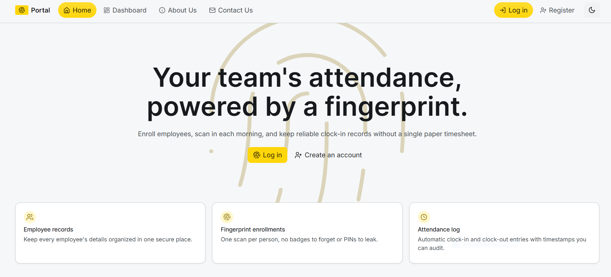
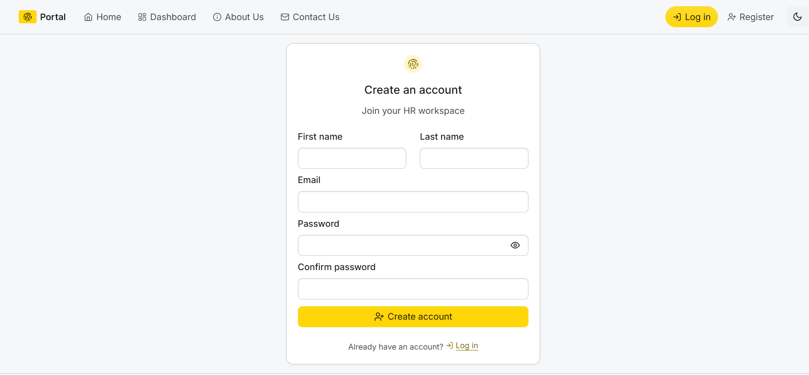
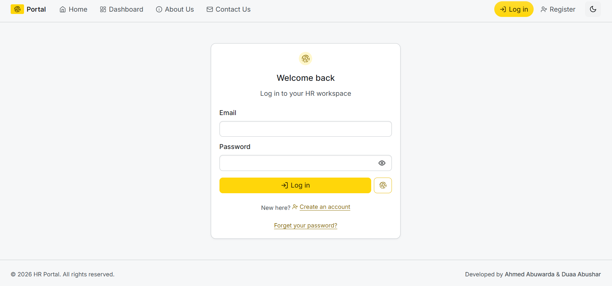
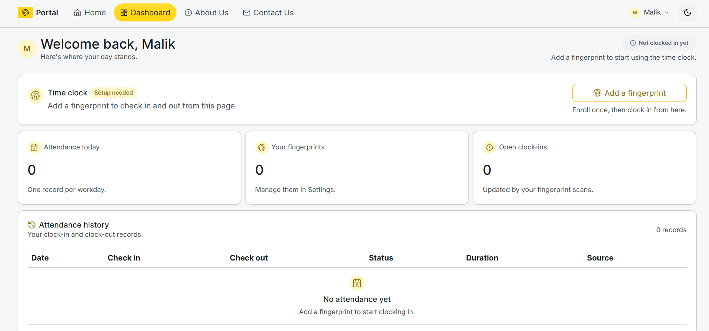
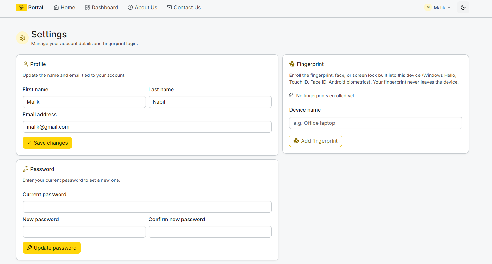
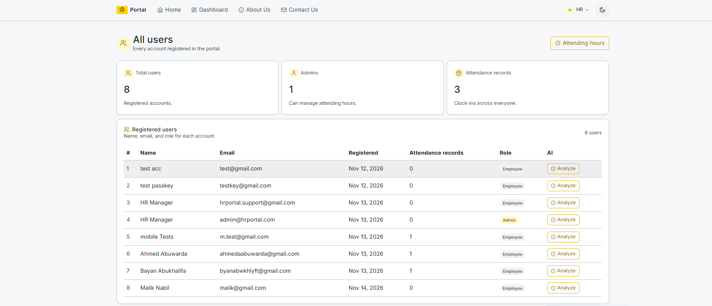
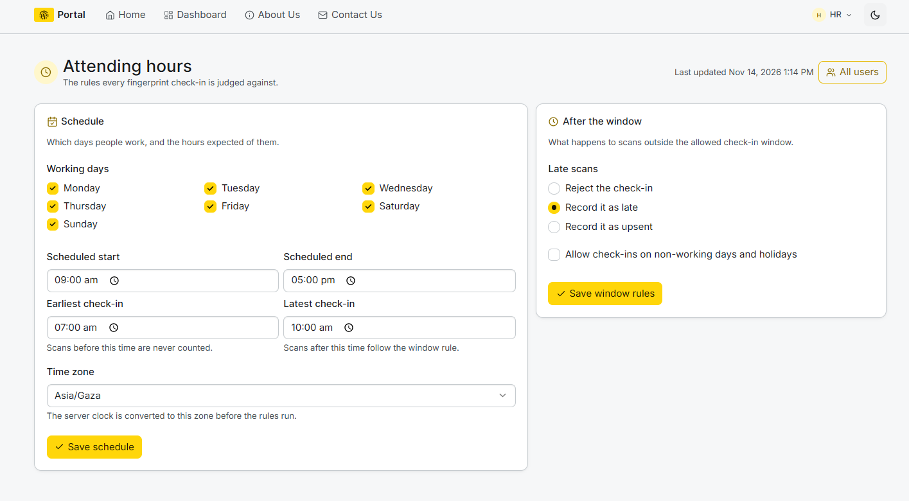
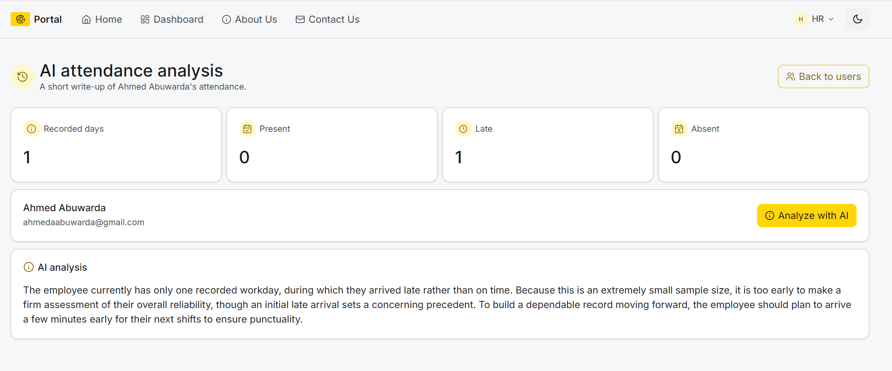

# HR Portal Management System

A Django-based HR portal for employee accounts, device-based passkey
authentication, and fingerprint-enabled attendance tracking. The
application provides employee dashboards and an administrator area for
managing attendance rules and reviewing attendance records.


## Table of Contents

-   [Overview](#overview)
-   [Live Application](#live-application)
-   [Features](#features)
-   [Technology Stack](#technology-stack)
-   [Application Architecture](#application-architecture)
-   [Data Models](#data-models)
-   [Authentication and Security](#authentication-and-security)
-   [Requirements](#requirements)
-   [Installation and Setup](#installation-and-setup)
-   [Configuration](#configuration)
-   [Database Setup](#database-setup)
-   [Running the Application](#running-the-application)
-   [Administrator Setup](#administrator-setup)
-   [Running Tests](#running-tests)
-   [Screenshots](#screenshots)
-   [Contributors](#contributors)

## Overview

The HR Portal Management System is designed to replace paper-based
attendance sheets and shared PINs with an online attendance workflow
using WebAuthn passkeys. Employees can create accounts, manage their
profile, enroll a device authenticator, and use it to sign in and record
daily check-in and check-out times.

Attendance decisions are evaluated on the server using
administrator-configured working days, scheduled hours, check-in
windows, time zones, and holiday rules. Administrators can view
registered users, configure attendance policies, and request an
AI-generated summary of an employee's attendance statistics.

## Live Application

The application is available at [hrportal.flashhub.net](https://hrportal.flashhub.net/).

## Features

### Employee features

-   **Account registration and login:** Create an account and sign in
    using an email address and password.
-   **Passkey enrollment:** Register a supported device authenticator,
    such as a fingerprint reader, Face ID, or another platform
    authenticator.
-   **Passkey login:** Sign in through the browser's WebAuthn API.
-   **Attendance clock:** Use an enrolled passkey to check in and check
    out from the dashboard.
-   **Attendance history:** Review attendance records, including work
    date, check-in, check-out, and attendance status.
-   **Profile management:** Update first name, last name, and email
    address.
-   **Password management:** Change the current password or use the
    email-based password reset flow.
-   **Passkey management:** View enrolled passkeys and remove them from
    the account.

### Administrator features

-   **User overview:** View registered accounts, account roles, and
    attendance-record counts.
-   **Attendance policy settings:** Configure working days, scheduled
    start and end times, earliest and latest check-in times, and the
    attendance time zone.
-   **Out-of-window policy:** Configure how scans after the allowed
    check-in window are handled.
-   **Holiday management:** Maintain holiday dates that affect
    attendance eligibility.
-   **Non-working-day control:** Choose whether check-ins are allowed on
    non-working days and holidays.
-   **AI attendance summary:** Request a short Gemini-generated write-up
    based on an employee's present, late, and absent attendance counts.

### Interface

-   Responsive Django-template pages.
-   Light and dark theme toggle, with the selected theme stored in
    browser local storage.
-   Reusable navigation, footer, notification/toast, and card templates.
-   Custom CSS and JavaScript for passkey workflows and dashboard
    attendance actions.

## Technology Stack

  -----------------------------------------------------------------------
  Technology                          Purpose
  ----------------------------------- -----------------------------------
  Python                              Application programming language

  Django 6.1.1                        Web framework, routing, templates,
                                      sessions, and ORM

  MySQL                               Relational database

  `mysqlclient` \>= 2.2.0             MySQL database driver

  `bcrypt` 5.0.0                      Password hashing and verification

  `webauthn` 3.0.1                    Server-side WebAuthn registration
                                      and authentication

  HTML and Django Templates           Application pages and reusable
                                      layouts

  CSS                                 Application styling

  JavaScript                          Browser-side WebAuthn and interface
                                      interactions

  Bootstrap 6.0.0-alpha.1 (CDN)       Front-end layout and components

  Google Gemini API                   Optional AI-generated attendance
                                      summaries
  -----------------------------------------------------------------------

The Python dependencies and pinned versions are listed in
`requirements.txt`. Bootstrap and Google Fonts are referenced from
external CDNs in the base template.

## Application Architecture

The project follows a Django project-and-app structure:

-   `hr_portal_management_system/` contains project-level configuration
    and URL routing.
-   `hr_portal_management_system_app/` contains the application models,
    business logic, views, templates, static assets, and tests.
-   The application uses Django sessions for its own account login flow.
    Its `User` model is a custom application model; it does not subclass
    Django's built-in `AbstractUser`.

### Project structure

``` text
HR-Portal-Management-System/
├── manage.py
├── requirements.txt
├── project_structure.txt
├── .gitignore
├── hr_portal_management_system/
│   ├── __init__.py
│   ├── settings.py
│   ├── urls.py
│   ├── asgi.py
│   └── wsgi.py
└── hr_portal_management_system_app/
    ├── __init__.py
    ├── admin.py
    ├── admin_panel.py
    ├── apps.py
    ├── attendance.py
    ├── attendance_rules.py
    ├── auth.py
    ├── helper_functions.py
    ├── models.py
    ├── passkey.py
    ├── tests.py
    ├── urls.py
    ├── utils.py
    ├── migrations/
    │   ├── 0001_initial.py
    │   └── 0002_attendancesettings_holiday_user_is_admin_and_more.py
    ├── templates/
    │   ├── admin/
    │   ├── auth/
    │   ├── icons/
    │   ├── partials/
    │   ├── user/
    │   ├── 404.html
    │   ├── about_us.html
    │   ├── contact_us.html
    │   ├── home.html
    │   └── layout.html
    ├── static/
    │   ├── css/
    │   │   └── app.css
    │   ├── images/
    │   │   ├── favicon-32.png
    │   │   └── favicon.svg
    │   └── js/
    │       ├── dashboard_check_in_out.js
    │       ├── fingerprint_helper_functions.js
    │       ├── login_checkin_using_fingerprint.js
    │       ├── register_fingerprint.js
    │       ├── show_hide_password.js
    │       ├── toast.js
    │       └── toggle_themes.js
    └── templatetags/
        └── attendance_extras.py
```

### Main modules

  -----------------------------------------------------------------------
  Module                              Responsibility
  ----------------------------------- -----------------------------------
  `models.py`                         Database models and model-level
                                      validation

  `auth.py`                           Registration, password login,
                                      logout, password reset, and
                                      password-change email

  `passkey.py`                        WebAuthn passkey registration,
                                      login, and deletion

  `attendance.py`                     Dashboard check-in/check-out
                                      WebAuthn endpoints

  `attendance_rules.py`               Working-day, holiday, time-window,
                                      and time-zone decisions

  `admin_panel.py`                    Administrator access checks, user
                                      list, attendance settings, and AI
                                      analysis

  `helper_functions.py`               Session helpers, WebAuthn
                                      verification helpers, and
                                      attendance recording

  `utils.py`                          Shared input normalization and
                                      date/time parsing

  `views.py`                          Django view entry points that
                                      connect URLs to application modules

  `tests.py`                          Automated tests for application
                                      flows and attendance rules
  -----------------------------------------------------------------------

## Data Models

The application defines the following main database models in
`models.py`:

  -----------------------------------------------------------------------
  Model                               Description
  ----------------------------------- -----------------------------------
  `User`                              Stores first name, last name,
                                      email, bcrypt password hash,
                                      administrator flag, and timestamps.

  `PasswordResetToken`                Stores a six-digit password-reset
                                      code, its creation time, and
                                      whether it has been used.

  `Passkey`                           Stores WebAuthn credential
                                      metadata, including credential ID,
                                      public key, signature counter,
                                      transports, label, and usage
                                      timestamps.

  `Attendance`                        Stores one employee's attendance
                                      record for a workday, including
                                      check-in, check-out, status, and
                                      associated passkey. A unique
                                      constraint prevents more than one
                                      record per user per workday.

  `AttendanceSettings`                Stores the configurable working
                                      schedule, time zone, check-in
                                      window, and
                                      non-working-day/out-of-window
                                      policies.

  `Holiday`                           Stores named holiday dates; each
                                      date must be unique.
  -----------------------------------------------------------------------

Attendance statuses are `present`, `late`, and `absent`. Attendance
records also store the method used; the current implementation uses the
passkey method.

## Authentication and Security

### Password authentication

-   Passwords are hashed with `bcrypt` before being stored.
-   Password login verifies the submitted password against the stored
    bcrypt hash.
-   Registration and password-change validation use Django's configured
    password validators as well as application-level checks.
-   Password reset uses a six-digit email verification code. The code is
    time-limited to 10 minutes and marked as used after successful
    verification.
-   The application sends a notification email after a password change
    or reset.

### WebAuthn passkeys

The browser uses the WebAuthn API through
`navigator.credentials.create()` and `navigator.credentials.get()`. The
server generates and verifies registration and authentication challenges
using the `webauthn` Python package.

The database stores the passkey's public credential information. The
application does not receive or store a user's raw fingerprint image;
biometric verification is handled by the device authenticator. Depending
on the device and browser, the authenticator may use a fingerprint, face
recognition, or another supported local verification method.

Passkey features require a secure browser context: use HTTPS when
deployed, or `localhost` during local development. Browser and device
support is also required.

### Important deployment security note

**Do not use the checked-in settings as production settings.** The
current `settings.py` contains a hard-coded development `SECRET_KEY`,
sets `DEBUG = True`, and leaves `ALLOWED_HOSTS` empty. Before deploying
your own copy:

1.  Revoke and rotate any credentials that have been committed or
    included in the archive, including API and email credentials.
2.  Remove the hard-coded key and update `settings.py` to read a unique
    production `SECRET_KEY` from a secure environment variable.
3.  Set `DEBUG = False` and configure `ALLOWED_HOSTS` for the deployment
    environment in `settings.py`.
4.  Use a dedicated, least-privilege MySQL account instead of a database
    root account.
5.  Configure HTTPS and review Django's production security settings.

The live site is linked above, but its existence does not mean the
checked-in development settings are suitable for production.

## Requirements

-   Python installed and available on your command line.
-   MySQL Server running locally or accessible over the network.
-   A MySQL database and user with permission to create and modify
    tables.
-   A modern browser with WebAuthn support for passkey features.
-   Internet access for the external Bootstrap and Google Fonts assets.
-   A Google Gemini API key if you want to use the administrator AI
    attendance analysis.

## Installation and Setup

### 1. Clone the repository

``` bash
git clone <repository-url>
cd HR-Portal-Management-System
```

Replace `<repository-url>` with the actual GitHub repository URL.

### 2. Create and activate a virtual environment

**Windows PowerShell**

``` powershell
python -m venv .venv
.venv\Scripts\Activate.ps1
```

**macOS / Linux**

``` bash
python3 -m venv .venv
source .venv/bin/activate
```

### 3. Install dependencies

``` bash
python -m pip install --upgrade pip
pip install -r requirements.txt
```

### 4. Create the MySQL database

Create a database using the name configured for the project. The default
database name in `settings.py` is `hr_portal_management_system`.

``` sql
CREATE DATABASE hr_portal_management_system
  CHARACTER SET utf8mb4
  COLLATE utf8mb4_unicode_ci;
```

Create or select a MySQL account with access to this database. Configure
its connection details using the environment variables described below.

## Configuration

`settings.py` loads a `.env` file from the repository root using
`python-dotenv`. The `.env` file is ignored by Git. Copy
`.env.example` to `.env` and set the values required for your local
database and email account:

``` dotenv
DB_NAME=hr_portal_management_system
DB_USER=your_mysql_user
DB_PASSWORD=your_mysql_password
DB_HOST=127.0.0.1
DB_PORT=3306

EMAIL_BACKEND=django.core.mail.backends.smtp.EmailBackend
EMAIL_HOST=smtp.gmail.com
EMAIL_PORT=587
EMAIL_HOST_USER=your_sender_email
EMAIL_HOST_PASSWORD=your_email_app_password

# Optional: required only for Gemini attendance summaries.
GEMINI_API_KEY=your_gemini_api_key
```

For Gmail SMTP, use a Google App Password rather than your account's
normal password. The current settings always enable `EMAIL_USE_TLS` and
derive `DEFAULT_FROM_EMAIL` from `EMAIL_HOST_USER`; neither setting is
read from `.env`. Database and email values are empty if omitted, and
Gemini summaries require `GEMINI_API_KEY`.

The current settings do **not** read `SECRET_KEY`, `DEBUG`,
`ALLOWED_HOSTS`, `EMAIL_USE_TLS`, or `DEFAULT_FROM_EMAIL` from `.env`.
Adding those variables to `.env` will not configure them without first
updating `settings.py`; in particular, the production security settings
described above must be implemented before deploying a copy.

## Database Setup

After configuring the MySQL connection, apply the migrations included in
the repository:

``` bash
python manage.py migrate
```

The project includes migrations for the application models. You normally
do not need to generate new migrations for a fresh installation.

## Running the Application

Start Django's development server:

``` bash
python manage.py runserver
```

Open the local development address shown by Django in your browser
(typically `http://127.0.0.1:8000/`).

For local passkey testing, use `localhost` or `127.0.0.1` as supported
by the browser's secure-context rules. A deployed site should use HTTPS.

## Administrator Setup

Newly registered application accounts have `is_admin=False` by default.
The reviewed application source does not provide a user-facing
role-promotion screen. To grant administrator access during initial
setup:

1.  Register the account through the application.

2.  Open the Django shell:

    ``` bash
    python manage.py shell
    ```

3.  Update the account's administrator flag, replacing the email
    address:

    ``` python
    from hr_portal_management_system_app.models import User

    User.objects.filter(email="admin@example.com").update(is_admin=True)
    ```

4.  Sign out and sign in again so the session reflects the updated role.

The custom administrator area is available to accounts with
`is_admin=True`. Its main pages are:

-   `/admin-panel/users`
-   `/admin-panel/attendance-hours`
-   `/admin-panel/ai-analysis?user=<user_id>`

The project also routes `/admin/` to Django's built-in admin site. The
HR portal's custom administrator area is the `/admin-panel/` section
described above.

## Running Tests

Run the application's Django test suite with:

``` bash
python manage.py test hr_portal_management_system_app
```

The test module includes coverage for password-reset flows,
passkey-related options, attendance-window decisions, absent-day
handling, administrator access, attendance settings, and AI-analysis
page behavior.

The presence of tests in the repository does not by itself indicate that
they have passed in your environment. Run the command above after
configuring the database and dependencies.


## Screenshots

-   Public home page

-   Registration and login pages


-   Employee dashboard and attendance history

-   Passkey enrollment in account settings

-   Administrator user list

-   Attendance schedule settings

-   AI attendance summary



## Contributors

The project's About page identifies the following contributors:

-   **Ahmed Abuwarda** --- Lead developer; architecture, WebAuthn
    passkeys, and attendance flows.
-   **Doaa Abushar** --- Co-developer; interface design, page templates,aws deployment 
    and user experience.
